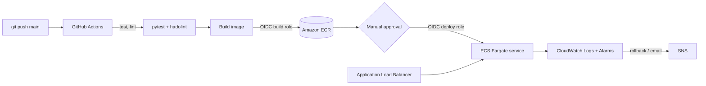

# Containerized CI/CD Pipeline — GitHub Actions → ECR → ECS Fargate

A small Flask service deployed to AWS ECS Fargate (ca-west-1) by a GitHub Actions pipeline with OIDC federation (no stored AWS keys), a manual approval gate, automatic rollback, and CloudWatch alerting. All infrastructure is Terraform.

## Highlights
- Multi-stage, non-root Docker image; ECR scan on push; immutable git-SHA tags
- Two least-privilege IAM roles via GitHub OIDC (build = push to ECR, deploy = update ECS)
- Approval gate through a GitHub `production` environment
- Rollback layers: CI gate, ECS circuit breaker, CloudWatch-alarm rollback, smoke-test rollback, manual `rollback` workflow
- Zero-downtime rolling deploys (100% min healthy / 200% max)

## Results (measured; details and method in [docs/metrics.md](docs/metrics.md))

| Metric | Result |
|---|---|
| Push to verified-live, median of 7 successful runs | **594 s (about 10 min)**, range 4.4-15.0 min, approval wait excluded |
| Stage medians | test 23 s, build and push 33 s, ECS deploy 536 s |
| Share of time in the ECS rolling update | 77-93% |
| Zero-downtime check | 1,200 requests during a live rollout, versions `c3cb2a6` (219) and `ffc8af1` (981), **0 failed** |
| CI gate | Broken test stopped the pipeline in 13 s; no AWS resources touched |
| Automatic rollback | Bad release (wrong container port) rolled back by the ECS circuit breaker; previous version kept serving; failure reported 329 s and 591 s after approval on two runs |
| Image size | 1.63 GB single-stage vs **187 MB** multi-stage (about 89% smaller) |
| Manual deploy (script machine time) | 315.5 s and 346.9 s on two runs, excluding hands-on typing and console steps |
| Manual actions per release | 2 (`git push`, one approval click) |

Image size and manual-deploy times are taken from my terminal screenshots. Not measured, so not claimed: a hands-on "% faster" comparison and the manual rollback workflow.

**Takeaway:** the CI half (test, lint, build, push) takes about a minute; the ECS rolling update is where nearly all the time goes, so health-check intervals and connection draining are the next things to tune.

## Run it
Follow [GUIDE.md](GUIDE.md) step by step. Tear down with `terraform -chdir=infra destroy`.

## Layout
`webapp/` app · `tests/` pytest · `Dockerfile` · `infra/` Terraform · `.github/workflows/` pipeline + rollback · `scripts/` PowerShell helpers · `docs/metrics.md`
