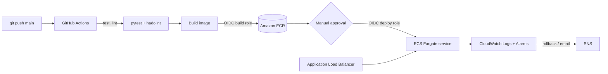

# Containerized CI/CD Pipeline — GitHub Actions → ECR → ECS Fargate

A small Flask service deployed to AWS ECS Fargate (ca-west-1) by a GitHub Actions pipeline with OIDC federation (no stored AWS keys), a manual approval gate, automatic rollback, and CloudWatch alerting. All infrastructure is Terraform.

## Highlights
- Multi-stage, non-root Docker image; ECR scan on push; immutable git-SHA tags
- Two least-privilege IAM roles via GitHub OIDC (build = push to ECR, deploy = update ECS)
- Approval gate through a GitHub `production` environment
- Rollback layers: CI gate, ECS circuit breaker, CloudWatch-alarm rollback, smoke-test rollback, manual `rollback` workflow
- Zero-downtime rolling deploys (100% min healthy / 200% max)

## Results (fill in with measured values — see `docs/metrics.md`)
| Metric | Before (manual) | After (pipeline) |
|---|---|---|
| Deploy time | _X min_ | _Y min_ |
| Manual steps | _N_ | 2 |
| Auto-rollback time | — | _Z min_ |
| Image size | _A MB_ | _B MB_ |

## Run it
Follow [GUIDE.md](GUIDE.md) step by step. Tear down with `terraform -chdir=infra destroy`.

## Layout
`webapp/` app · `tests/` pytest · `Dockerfile` · `infra/` Terraform · `.github/workflows/` pipeline + rollback · `scripts/` PowerShell helpers · `docs/metrics.md`
